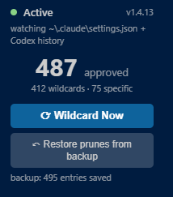
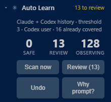
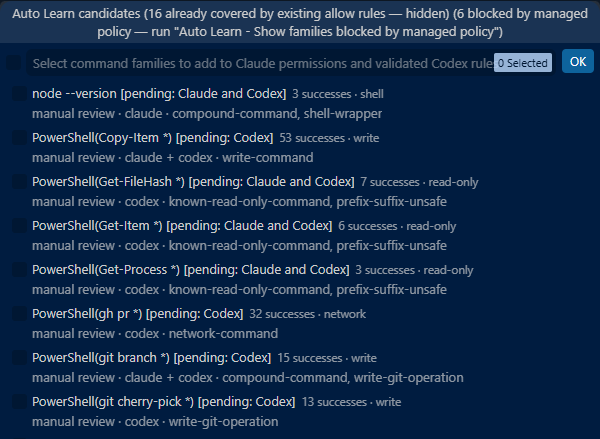
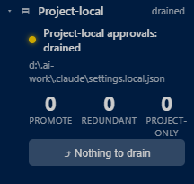
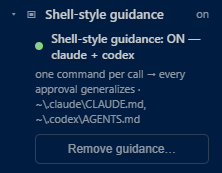
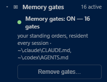
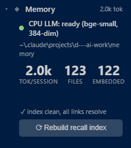

# AI Acolyte

*Formerly Permission Wildcarding. The extension ID, every command ID and every setting key
are unchanged, so an existing install upgrades in place.*

**Reduce repeated approval prompts.** AI Acolyte is a VS Code extension plus a CLI.
For Claude Code it watches `~/.claude/settings.json` and generalizes individual
approvals into command families. Auto Learn reads Claude Code and Codex history
and emits policy in each agent's native format.

**Version 1.9.0 keeps the memory index lean**: an optional MEMORY.md guard hook refuses an edit
after which the index ends past a budget and is worse than before, an Open threads block carries each memory's open status
into every session in place of index lines, and Toggle Auto Learn switches Auto Learn from the
dashboard (a workspace may now only turn it off). One Windows process-spawn race is fixed (the
Codex version probe inherited another spawn's pipes, so it read "timed out"), and a tree kill its
caller started now reads as ended.
**Version 1.8.1 groups the dashboard rows** under Activity, Memory & instructions and Permissions,
with Agent sessions first. **Version 1.8.0 gives the two memory rows the same features**: Claude memory gains Search,
Inspect memory sources, a gates line and the Claude Code version, and Codex memory gains the CPU model
line, four figures and an issues line. **Version 1.7.2 renames the Memory row Claude memory**, to match Codex memory beside it.
**Version 1.7.1 lays each Agent sessions row out on two lines**, so a long folder name is no
longer squeezed to one character wide, and the header line reads "watching Claude & Codex history". **Version 1.7.0 shows how often each saved rule is used,
and which agent sessions are active**: the Saved permissions card counts each Claude allow rule's use over all your
transcripts and offers the rules with no use found for review, and a new Agent sessions row
lists the Claude and Codex sessions active in the last 15 minutes. Version 1.6.8 reads the
Codex transcripts Codex compresses: Codex rewrites an idle rollout as
`.jsonl.zst`, and Auto Learn now reads those as it reads plain ones, so they no longer show as
missing threads and a false "scan degraded". Version 1.6.7 lets a workspace only tighten Auto
Learn: a repository's settings can lower
the mode, raise the threshold, or turn Codex export or the local drain off, but never loosen them.
Version 1.6.6 warns when a Claude Code update changes its safe-variable list, checked once
per new Claude Code binary in the background. Version 1.6.5 added per-agent memory gates and
retire/restore: a gate marked `agents: [codex]`
reaches only Codex, one gate can be switched off and back on, gates compile and install atomically,
and gates in other memory stores are reported instead of silently ignored. Version 1.6.4 made
Review answer every click: the Auto Learn card counts only what Review
can act on, and Review shows progress, waits for a scan already running and says plainly when
nothing needs review. Version 1.6.3 fixed what a post-release audit of 1.6.2 found: the dashboard never blocks
the extension host, a missing Codex root holds an Auto Learn rebuild open, informational rules
are proposed again, the Codex exporter refuses every prefix that can run an unpinned program,
and the hook registers asynchronously. Version 1.6.2 stopped two false dashboard warnings and
follows Codex 0.161.0 and Claude Code 2.1.296's own matching; 1.6.1 combines Claude and Codex
in one Saved permissions list; 1.6.0 adds core Codex feature coverage. Real
extension-host and fresh-session checks cover the supported workflows below. The feature
inventory and evidence are in [`docs/codex-compatibility.md`](docs/codex-compatibility.md).



What you get:

- Far fewer approval prompts, without hand-editing a settings file.
- One dashboard for Claude Code policy and reviewed Codex rule export.
- Proposals earned from what you actually ran, not a guessed-at allow list.
- Claude Code's `permissions.deny` list still wins on every sub-command.

---

## Install

```bash
git clone https://github.com/bigfnj/ai-acolyte
cd ai-acolyte
./install.sh            # or .\install.ps1 on Windows PowerShell
```

That registers the `PostToolUse` hook. Run it again after moving, renaming or re-cloning
the checkout: it repoints a registration left by another checkout of this tool instead of
adding a second one beside it, and prints the old and new paths. On Windows, `./install.sh`
from Git Bash and `.\install.ps1` register the same `node "<path>"` command, and either one
rewrites the bare-path registration an older Git Bash install left, which made Windows ask
how to open the file on every hook fire. For the dashboard in the screenshots, install the
extension too:

```bash
npm run package                                   # builds the .vsix
code --install-extension ai-acolyte-v190.vsix
```

Name the version rather than globbing it. Old builds accumulate in the repo root, they
are gitignored so `git clean` will not take them, and `ai-acolyte-v*.vsix`
can hand VS Code the older one. Installing an equal or lower version is a silent no-op,
so that failure presents as "the upgrade did nothing".

The repo itself has no dependencies, no lockfile and no `node_modules`. `npm run package`
does fetch one: it shells out to `npx --yes @vscode/vsce`, which downloads the packaging
toolchain on first use. Node 20 or later, VS Code 1.80 or later.

Upgrading from a release that exposed MAX does not leave an enable path behind.
The extension offers an automatic review only when the exact retired Claude hook
is still registered. Snapshot-only state can be stale, so it is left inert and
used to stop old backup copies from reasserting generated blanket grants. A
CLI-only installation can explicitly run `wildcard-perms --max off` or
`wildcard-perms --codex-max off`; those hidden compatibility commands can only
inspect or remove old state, and `on` always fails without writing.

---

# What it does

The dashboard groups the features below into cards. Every screenshot below is the
real UI.

Claude Code and Codex use separate policy mechanisms. The table describes the
current implementation and tested outcomes. The compatibility record states which
inputs and configurations were exercised and which boundaries remain open.

| Capability | Claude Code | Codex |
|---|---|---|
| Generalize existing approvals | implemented for allow-list entries | reviewed widening of stored literal approvals passes editor checks |
| Promote project-local approvals to user scope | implemented | reviewed import preserves source rules and accompanying restrictions; editor/runtime checks pass |
| Auto Learn backup before apply, with undo | implemented | real-host apply/undo checked with synthetic history |
| High-water allow/deny backup and restore | implemented | retained literal rules and reviewed restoration; fresh-process checks pass |
| Tracked-wildcard inventory and prune | implemented | literal local rule inventory, confirmed allow-rule removal and shared suppression |
| Post-tool approval hook | `PostToolUse` hook | Stop callback learns completed turns with the editor closed; Codex hook review required |
| Auto Learn over session history | implemented | shell learning implemented; actual runtime transcripts parsed |
| Reviewed and auto-safe policy output | allow-list entries | safe apply checked; generated rules exercised in fresh sessions |
| Shell-style guidance | `CLAUDE.md` writer | active Codex instruction file; custom home and override support |
| Memory gates | instruction-file writer | explicit native global sections compile to a separately reviewed Codex block; automatic updates, overrides and removal verified in the editor and fresh Codex sessions |
| Memory index and lint | Claude memory directories | native discovery, diagnostics, semantic search and index rebuild pass real-editor checks; unavailable models visibly fall back to keywords |
| Derived guidance for recurring friction | implemented | reviewed Codex advice based on current managed policy and observed Codex runs |
| "Why did this prompt?" diagnostics | implemented | partial: local rules and cached managed requirements |

Codex rule export remains **experimental**. The feature-by-feature acceptance
matrix and dated evidence are in
[`docs/codex-compatibility.md`](docs/codex-compatibility.md).

Version 1.6.0 adds **Show Codex rules** (`vscode-extension/extension.js:3193#showCodexRules`).
It lists local rules and confirms removal of a selected literal allow declaration
("Remove this Codex allow rule?", `vscode-extension/extension.js:5230#showWarningMessage`). Current Auto Learn builds remember removals across
workspaces. Computed policy remains read-only. This feature is included in the
1.6.0 package; development checks used isolated staging before release preparation.

Version 1.6.0 also adds **Restore Codex rules**
(`vscode-extension/extension.js:5030#showCodexRestorePicker`). Restore preserves current rules and deliberate
removals. The retained catalog lives under the user's `.ai-acolyte/backups` directory
(`src/auto-learn-manager.js:1427#codexBackupPath`). Codex derived guidance has separate policy and run
evidence (`src/auto-learn-manager.js:1862#derivedFor`); observed runs are not reported as measured
approval prompts. Actual restore and guidance controls now pass in a staged VS Code
host, with deliberate no-op controls that fail the intended checks. The detailed
development evidence and supported boundaries remain in the compatibility document.

## 1. Wildcarding (Claude Code)

The core, and the card at the top of this page. Every time you approve a command,
the hook fires and rewrites your allow list so the approval covers its whole command
family. Fixed-purpose tools collapse to their root, so `rg` becomes `Bash(rg *)`.
Mixed-capability tools like `git`, `docker` and the package managers keep their
subcommand boundary, so approving `git status` does not silently approve `git push`.

> **Buys you:** the single biggest reduction in prompts, automatically, with no
> decision to make. That card shows 487 approved entries, 412 of them wildcards
> covering a whole family and only 75 still pinned to one exact command.

Because Claude Code checks each sub-command of a compound separately, one root
wildcard also clears prompts inside pipelines and `&&` chains.

## 2. Auto Learn (Claude Code and Codex)



Wildcarding only reacts to approvals you have already given. Auto Learn goes
looking: it reads your Claude Code and Codex history, finds command families you
keep running successfully, and proposes them before they prompt you again.

> **Buys you:** prompts that never happen in the first place, rather than prompts
> you dismiss faster.

Nothing is applied silently. Candidates are sorted into what is safe to apply
automatically and what needs you to look at it:



Each row shows the family, which agents it applies to, how many successful runs
back it, and why it was classified that way. A family that a managed policy already
blocks is labelled as such instead of being offered as a fix that cannot work.

## 3. Project-local approvals (Claude Code)



Approvals you give inside a project land in that project's
`.claude/settings.local.json` and stay there, so the same approval is asked again in
the next project. This promotes the portable ones to your user scope and prunes what
user scope now covers.

> **Buys you:** an approval given once in one repo stops being asked in every other
> repo.

Only entries that are genuinely portable are promoted. Anything tied to that
project's paths stays where it is.

## 4. Shell-style guidance (both agents)



A permission is stored as the command string that was approved. One command per
call becomes a reusable wildcard; a compound command is stored verbatim and matches
nothing ever again. So the agent's own shell habits decide how much you get
prompted.

> **Buys you:** fewer prompts created in the first place, by teaching the agent to
> write commands that can be generalized.

This installs a short managed block into `~/.claude/CLAUDE.md` and the active Codex
user instruction file. Codex paths follow `CODEX_HOME` when set, otherwise `~/.codex`.
A nonempty `AGENTS.override.md` takes precedence over `AGENTS.md`; an empty override
stays empty. One toggle removes the managed block while preserving your own text.

## 5. Memory gates (both agents)



Your standing orders, made resident. Mark a memory file with a gate block and it is
compiled into the instruction files both agents read at the start of every session.

> **Buys you:** the rules you actually care about are in force every session,
> instead of being rediscovered or ignored.

The compiler is deliberately strict: a gate must say where it belongs, and one that
does not is reported rather than guessed at. The extension watches the memory
directory and recompiles when a gate changes.

A gate is for both agents unless it says otherwise. To keep one to a single agent, name the
agent in the memory's frontmatter, beside `scope:`:

```yaml
metadata:
  scope: global
  agents: [codex]      # or [claude], [claude, codex], or a bare codex / claude
```

Names are case-insensitive, and a block list (`- codex` lines under `agents:`) works too. No
`agents:` line, or an empty one, means both agents. A name the compiler does not know, or two
`agents:` lines, is never guessed at: that gate is left out for both agents, and
`recall.py --lint` and the dashboard name it. `--gates status` and the card give each agent's
own count, such as "Claude 13 · Codex 14", and a gate moved from one agent to the other leaves
the first on the next compile.

To set one standing order aside without losing it, retire it. **Manage gates…** on the card, or
**AI Acolyte: Manage memory gates…** from the palette, lists every gate memory in the store that
compiles, with the agents each one is for. Uncheck a gate and apply: its memory's `scope: global`
becomes `scope: retired` and nothing else in the file changes, its `agents:` line included. Recall
still finds the memory, and from the next session the gate no longer loads in `CLAUDE.md` and
`AGENTS.md` (or only in the one its `agents:` line names). Check it again to restore it, to the same
agents. A confirmation says what each file will load first. The memory folder is snapshotted
before every change into `~/.claude/wildcarding/gate-snapshots` (set `AI_ACOLYTE_GATE_SNAPSHOT_DIR`
to move it), and the newest 30 snapshots of each store are kept. The change is compiled either
way, and installed only while memory gates are on: gates you switched off stay off. From a
terminal, `wildcard-perms --gates list`, `--gates retire <memory>` and `--gates restore <memory>`
do the same. Only the store that compiles is changed, never the other stores the card reports.

## 6. Open threads (both agents)

Status gets a home outside the memory index. Claude Code loads only the first 200 lines of
`MEMORY.md`, and status written on index lines ("DONE", "AWAITING the owner") is what fills them.
Instead, a memory says it is still open in its own frontmatter, and the open ones are listed in a
managed block that both agents read at the start of every session.

> **Buys you:** every session knows what is still waiting, and the index stays a list of hooks.

```yaml
---
name: dashboard-layout
metadata:
  type: project
  status: awaiting       # open, awaiting, blocked or deferred
---

The memory itself.

<!-- status -->
Waiting on the owner's choice between the two layouts.
<!-- /status -->
```

Each open memory is one line of the block, `- **AWAITING** <text> (<file stem>)`, the stem being
the memory's file name without `.md`. Lines are sorted by status (open, awaiting, blocked,
deferred) and then by stem. The text is the status block's, on one line, with control characters
and bidirectional controls removed, cut at 240 characters. At most ten are listed, and
one more line counts the rest and points at `recall "status"`. `done`, `closed`, `live`,
`shelved`, `deleted`, `dropped` and `shipped` close a thread: the memory stays, and its line
leaves the block on the next compile. Any other value, two `status:` lines, or a listed status
whose block is missing or sits only inside a code fence is left out, and `recall.py --lint`
names it.

While `MEMORY.md` is past 140 lines, 12000 bytes or a 300-character line, the block also carries
an INDEX line telling every new session to compact it before adding anything. The line names the
index it measured, home-relative (`~/.claude/projects/<slug>/memory/MEMORY.md`), because the block
reaches sessions in every project and each project has an index of its own. It reaches sessions
on a machine whose managed policy keeps user hooks from running.

The feature is on by default. `recall.py --threads-compile` writes
`~/.claude/open-threads.generated.md` from the store the gates compile from, and leaves the file
untouched when the new compile is identical. The extension recompiles after a memory edit that
can change the list (a `MEMORY.md` edit only when the INDEX line could change), a few seconds
after activation when there is anything to say, and when the feature is turned on. It runs one
compile at a time, off the extension host thread. It installs the result into
`~/.claude/CLAUDE.md` and Codex's `AGENTS.md`, or a nonempty `AGENTS.override.md`. With nothing
open and the index within its budgets, the block is removed.

To turn it off, click **Turn off open threads** on the Claude memory card, run **AI Acolyte:
Toggle open threads**, or set `permissionWildcarding.openThreads.enabled` to `false` in user
settings. Turning it off always turns it off, whatever state the install is in; while it is off
the extension neither compiles nor installs it. When the install is not current (nothing compiled
yet, a compile it refused, an instruction file it cannot read, or a block that differs from the
compile), the card also shows
**Refresh open threads**, and the toggle's confirmation offers **Refresh**: both compile and
install and leave the setting on. The Claude memory card is hidden while
`permissionWildcarding.memory.enabled` is `false`, and the open-threads line and buttons with it;
the feature keeps running, and the palette command and the setting still reach it. From a
terminal, `wildcard-perms --open-threads on|off|status|refresh`.

## 7. Recall over your memory



A local CPU model indexes your memory corpus so you can ask for something in plain
words and get the right file back, without reciting an exact filename.

> **Buys you:** memory you can search by meaning, entirely on your machine. No API
> call, no token cost, nothing leaves the box.

It runs on bge-small ONNX fused with BM25, and only changed files re-embed. The card
also lints the index: size against the budget that is actually loaded every session,
broken links, and gates that were written but never compiled.

The **Claude memory** and **Codex memory** rows work the same way, because they are
the same tool over two agents. Each shows the CPU model, four figures and an issues line. Each
has **Search**, **Rebuild** and **Inspect memory sources**, a gates line with **Review**, and its
agent's version. Codex's per-session figure is its `memory_summary.md`, which a Codex session
loads when its memory is on. The two keep separate indexes on purpose, so a search of one
agent's memory never returns the other's.

### The MEMORY.md guard (Claude Code, optional)

Claude Code loads the first 200 lines of each project's memory index, `MEMORY.md`, into every
session and strips its HTML comments. An index grows one reasonable hook at a time, and the lint
can only report the result afterwards. The guard is a `PreToolUse` hook that refuses the edit that
causes it. It is off until you turn it on.

It judges a `Write`, `Edit` or `MultiEdit` of `<config>/projects/<project>/memory/MEMORY.md`, where
`<config>` is `CLAUDE_CONFIG_DIR` or `~/.claude`, or of `MEMORY.md` in the `autoMemoryDirectory`
your `settings.json` names. Any other file is let through without being read. It replays
the edit and blocks only when a measure **ends past its budget and is worse than it was**
(`src/memory-index-guard.js:223#verdict`):

| Measure | Budget |
|---|---|
| lines | 140 |
| bytes | 12,000 |
| longest line, in characters (any line, not only entries) | 300 |
| resident `- ` entries | 16 |
| broken HTML comments: a `<!--` inside an open comment, an orphan `-->`, a `<!--` never closed | 0 |

The worse-than-before half is what makes it safe over an index that is already too big. It also
means the first step past a budget is refused: 140 lines to 141 is worse and ends past it. Deleting
whole lines can only lower the first four, so compacting by deletion gets through, and at 16
entries a new one has to replace an old one. A deletion that breaks an HTML comment or a code
fence is refused: removing only a comment's `<!--` or `-->` line, or the fence that kept a `<!--`
from being a comment, would load the comment's body into every session. A smaller file is not
automatically a pass either: joining two lines into one longer than 300 characters makes the
longest line worse. When it blocks, Claude Code shows the model each measure with its value and
budget and the fix: move detail and status into the memory file for a size measure, and close or
remove the whole comment for a broken one, whose first defect it locates by line.
Anything the guard cannot judge is let through: a payload over 8 MiB, an `old_string` that is not
in the file, a `MEMORY.md` it cannot read.

Turn it on with **AI Acolyte: Toggle MEMORY.md guard**, the button on the **Claude memory** card,
or `wildcard-perms --memory-guard on`. `off` removes only its own entry and `status` says what is
installed. Turning it on copies the guard to `~/.claude/wildcarding/memory-index-guard.js` and
registers that copy in `~/.claude/settings.json`, run by the absolute `node` found on `PATH`
(`src/claude-hook-config.js:62#memoryGuardDefinition`); on Windows, when `PATH` has none,
`%ProgramFiles%\nodejs\node.exe` (`src/memory-guard-install.js:113#resolveNodeExecutable`). If
that node later disappears the status reads `on (needs repair)`, and turning the guard on again
(the card's **Repair** button) re-points the hook at the node found then. Where `CLAUDE_CONFIG_DIR` is set, every
`~/.claude` path in this section is that directory instead, as it is for Claude Code
(`src/memory-guard-install.js:70#configDirFor`). The copy outlives upgrades and is replaced
only by a newer guard revision. Your `settings.json` as it was before the first change is kept in
`~/.claude/backups/settings.json.pre-memory-guard`; when there was no `settings.json` then, a
`settings.json.pre-memory-guard.absent` marker beside it says so, and no later change takes a
snapshot. A hook is the guard's own only when its
command is a `node` and that copy and nothing else. If another hook already runs a
`memory-index-guard.js`, from a different path or wrapped in a command of your own (`timeout 5
node "<copy>"`), turning the guard on refuses, and that hook is never touched.

**Managed policy can stop it running.** Where a managed policy sets `allowManagedHooksOnly` or
`disableAllHooks`, current Claude Code runs no user hook at all (see the correction under
[watch the cause](#design-principle-watch-the-cause-do-not-hook-the-event)), so the guard is
installed and inert. The card, the toggle and `--memory-guard status` say so whenever a local file
shows it: a `managed-settings.json`, the cached `~/.claude/remote-settings.json`, or
`disableAllHooks` in your own settings (`src/memory-guard-install.js:190#hookPolicy`), and
`--memory-guard status` names the file on a `source:` line. A policy delivered from a server may
leave no local trace, so where nothing is found they say they cannot tell, and the probe asks
Claude Code: **AI Acolyte: Check whether Claude Code runs user hooks** in the extension (it asks
first), or `wildcard-perms --memory-guard probe`. The probe runs
`claude -p "/goal reply with the word acolyte-probe-ok and stop" --tools "" --no-session-persistence`
once, in an empty directory of its own, `~/.claude/wildcarding/ai-acolyte-memory-guard-probe`,
with your own environment. The goal is inert and the run has no built-in tools and no saved
session; `claude --help` lists no turn limit, so the bound on time is a 60 second deadline that
ends the whole process tree. It never passes `--strict-mcp-config`: on Claude Code 2.1.293 that
flag makes `/goal` run under a policy that blocks user hooks, so the probe would read "not
restricted" while hooks stay blocked. An existing directory there is used only when it is empty and yours; anything else
is refused and Claude Code is not run. The answer reads Claude Code's own text: "restricted" is
its refusal message, "not restricted" needs the goal's word in the answer, and anything else,
a reworded message included, is "unknown". Where hooks are allowed, the probe is one short real
Claude Code turn. Claude Code still creates one project folder for the directory under
`~/.claude/projects` (holding an empty `memory/`, and no transcript), and the fixed name keeps it
to one. The lint keeps reporting the same measures either way.

**What has been observed, and what has not.** The development box runs under a managed policy
that sets `allowManagedHooksOnly`. The probe answered "restricted" there on 2026-10-19 (the 1.9.0
probe, about 5 seconds, Claude Code 2.1.301) and on 2026-10-20 (the probe above, from the CLI with
the real home, 4.3 seconds, Claude Code 2.1.293). Two hazards give a false "not restricted":
`--strict-mcp-config` (measured on that box), and a probe run outside your real environment (a
throwaway `HOME`, `USERPROFILE` or `CLAUDE_CONFIG_DIR`), because the answer is only true of the
config directory Claude Code reads. A "not restricted" answer from a
correctly run probe has not been seen. Nor has the guard's refusal itself: a real Claude Code
session running the hook, the hook exiting 2 and Claude Code handing its message to the model
has not been observed end to end, and every test drives the hook directly, the way Claude Code
is documented to run it.

The editor gauge and `recall.py --lint` count lines, line widths and broken comments exactly as
the guard does, and `recall.py --lint` also holds the entry count to 16;
`test/memory-guard-parity.test.js` measures the same indexes with all three. The extension's
`memory.lineBudget` and `memory.totalBudget` settings tune the gauge only; the hook always uses
the budgets above.

## 8. Saved permissions (Claude Code and Codex)

The **Saved permissions** row combines Claude allow entries and local Codex allow
rules, with an agent label on each entry. Its 12-entry preview alternates agents;
the overflow link and **View / remove permissions** open one searchable list.

> **Buys you:** the ability to answer "why is this allowed?" without reading a JSON
> file.

Backups are taken before every write. Expand **Permission tools** and choose
**Restore permissions**, then **Claude Code**, to recover entries a pass removed.

**How often each rule is used.** A muted line under the list counts how often each saved
Claude allow rule covered a call, for example "Rule use since Aug 7: 261 used · 257 with no
use found — review".
- **What it reads:** every Claude transcript on the machine, matched against the rules as
  they are now. It runs in the background, daily and after the list changes, and takes
  about 10 s over 1.9 GB of history.
- **Recounting:** **Count how often each saved Claude rule is used** recounts at once.
- **Reviewing:** **review** opens the list filtered to the rules with no use found. Each
  removal is still confirmed one at a time.

"No use found" is not "unused". Sessions that keep no transcript (`claude -p
--no-session-persistence`, the Agent SDK) are invisible to it, and so is history Claude has
already cleaned up. Codex calls are not counted, and Skill rules and file rules with a path
are not tracked. A deny or ask rule, yours or the managed policy's, takes the credit for any
call it decided. Only counts are stored, keyed by a hash of each rule.

> **Buys you:** a list worth pruning, without deleting a rule something still uses.

## 9. Agent sessions

The **Agent sessions** row lists the Claude and Codex sessions that wrote a transcript in the
last 15 minutes. For each one it shows:
- the agent and the app (VS Code, CLI or desktop);
- the name of the project folder;
- the permission mode, when the transcript records it;
- when it was last active, and how many of its subagents are working.

It reads only the transcripts, so it sees sessions in every app and needs nothing switched on.
It cannot tell whether a session is waiting on a permission prompt: that is the panel's own
state, which an extension cannot read.

> **Buys you:** one place to see what every agent on the machine is doing right now.

---

## How it actually works

Mechanism only, and the decisions where the obvious implementation is wrong. The narrative version
is in `docs/engineering-record.md`.

### The hook path

`bin/wildcard-perms` with no arguments is the `PostToolUse` hook. It reads the event from stdin
and `~/.claude/settings.json` once, then asks `src/fixed-point-cache.js` whether those exact bytes
are already known to be a fixed point of `processAllowList`. A hit skips the parse, the pass and
the require chain that reaches it. The whole cache file is its own key, and part of that key stats
the code itself, so an in-place checkout self-invalidates. Every failure degrades to a miss, never
a hit: a wasted pass is what the hook did before the cache existed, while a spurious hit skips a
due generalization forever.

On a miss the pass runs unlocked as a negative test only, so a stale read costs nothing while the
list is already a fixed point, and everything authoritative is redone inside the lock the moment
the result differs. `finish()` is the one exit path and takes a single lock acquisition covering
both the wildcarding write and the project-local drain; locking them separately left a window for
Auto Learn to land its settings write and its claims write in between. A busy lock stays silent,
because the next tool call fires the hook again and the pass is idempotent. That is also what
makes it safe to register the hook with `"async": true`: its work is for the next prompt, so no
tool call waits on it, and two runs that overlap simply contend for the lock.

### Generalization, coverage, and the local drain

`generalizePermission` touches only `Bash(...)` and `PowerShell(...)`. An argument already ending
in `*` is returned as-is, preserving existing wildcards rather than narrowing them, and a quoted
or path-rooted executable (a first token holding `/` or `\`, or opening with `~` or a drive
letter) is left verbatim. A Bash entry first loses the wrappers Claude Code
itself strips before matching (`timeout`, `time`, `nice`, `nohup`, `stdbuf`, `command`, `builtin`,
`noglob`, and `xargs` without flags), so `timeout 5 rg x` keys on `rg`; `command -v` keeps its
flag. A leading environment assignment goes too, but only when Claude Code strips it: one of its
39 known-safe variables (`NODE_ENV`, `CI`, `LANG`, ...) with a plain value. Any other assignment
stays in the rule as written, `GITHUB_TOKEN=x git push origin` becoming
`Bash(GITHUB_TOKEN=x git push *)`, because Claude Code will not match `Bash(git push *)` past it
(docs/claude-code-permissions.md, section 3). Everything else collapses to `Tool(<root> *)`,
destructive roots included, except the 16 roots in `MIXED_FAMILY_ROOTS`, which keep one
subcommand, and PowerShell's `&` call form, which stays exact because a root-wide call-operator
wildcard is arbitrary execution. The safety boundary is `permissions.deny`, which always wins and
is evaluated per sub-command.

Coverage is one function, `isCoveredBy`, which is `!sameRule && ruleMatches`, built on
`src/permission-match.js`, the only implementation of Claude Code's matching rules and shared with
the dashboard so the two cannot drift. It models the same wrapper and known-safe environment strip
Claude Code's allow matcher applies, as a subset, so `Bash(rg *)` covers `Bash(timeout 5 rg x)` and
`Bash(xargs rg x)`; the generalizer and the learner share that one routine. Both sweeps are narrowed
by an index that deliberately does
not reimplement matching: it narrows the candidate set while `isCoveredBy` still decides every
answer, so a false positive costs one regex while only a false negative could change a result.
That asymmetry is why `test/cover-index.test.js` can assert cover-sets identical to the scan's.

The drain in `src/local-settings.js` promotes, verifies, then prunes, and that order is not
negotiable: coverage is re-read from disk after the write, never assumed from what the pass meant
to write, so a failed or policy-filtered promotion cannot revoke a grant the project already had.

### Writing settings.json safely

`src/settings-write.js` is the only sanctioned writer, because Claude Code rewrites that file in
place on every approval, so a naive read-modify-write reverts what landed in between. `writeAllow`
replays the caller's delta onto a fresh read, refuses when the file exists but does not parse, and
treats deny as additive only, never rebasing it away. `writeTransform`, the second writer, runs
the caller's transform against a fresh read, writes the result verbatim, and compare-and-swaps on
the raw bytes. It is the path for changes that cannot be represented as an additive allow-list
delta while still preserving concurrent edits.

Every in-process policy writer takes one advisory lock; instruction files get a separate one per
target file (`instructionLockPath`, `src/agent-guidance.js:490#instructionLockPath`), and
`withInstructionLock` (`src/agent-guidance.js:499#withInstructionLock`) takes it around the read as well as the write,
since locking the write alone still admits a writer between this one's read and its own write.

### Auto Learn

Scanning is incremental over both agents' JSONL transcripts, with cursors keyed as
`path-sha256:<24-hex>` so persisted state discloses no history paths. A Claude `tool_use` is
correlated with its `tool_result`, a Codex `function_call` with its `function_call_output`; a
requested call is never evidence, unanswered calls are ignored until a result arrives, and
confirmed failures are negative evidence that bars `auto-safe` without raising the threshold.

Attribution within one call decides correctness, because one `tool_result` carries one exit status
however many commands the string held. An all-`&&` chain proves every link ran and exited zero;
the final segment of a `;`, newline or pipe chain carries the overall status; a `||` branch proves
nothing about either side. A segment whose outcome cannot be attributed earns no evidence and no
family, so `false` in `git status; false; rg --version` is never a success.

`classifyInvocation` ranks risk from read-only up through write, shell, network, credential, admin
and destructive, and `autoSafe` needs `risk === 'read-only'`, a known read-only root, no
structural block (shell structure, a write redirection, no renderable permission, or a prefix that
is not suffix-closed), plus `successThreshold` confirmed successes, default 3, and zero failures.
Suffix closure is a property of the pattern, not the observation. A trailing `*` admits shell
syntax as readily as arguments, so `Bash(echo *)` also matches `echo <anything> > <anywhere>`, and
an allow pattern cannot exclude a redirection. `AUTO_SUFFIX_CLOSED_ROOTS` therefore holds only the
13 roots where no argument can reach stdout, leaving review-only every root whose argument is its
output and `git cat-file`, whose `--textconv` runs the repository's own diff driver. The accepted
residual: every auto-safe root still permits `whoami > somefile`.

Applying is transactional and recorded in a claims registry, and Undo releases this claimant's
grants through it rather than restoring bytes, so an approval persisted meanwhile does not block
Undo and a permission another workspace still claims is never revoked. Codex rules are exact argv
prefixes validated by `codex execpolicy check` before they are written. The families in
`src/tool-learn.js` stay review-only at every threshold: the exact MCP tool observed and never a
server wildcard, a `WebFetch(domain:host)` whose path and query are never kept, and for file tools
nothing at all.

### Managed policy, and the prompts no rule can stop

`src/managed-policy.js` reads the policy cache Claude Code keeps on disk, and verdicts from it are
never cached, because that file is a client-refreshed copy and a stored verdict could contradict
it. A managed `deny` or `ask` outranks every user allow, so a family a managed rule overrides
entirely is withheld from Review but still counted and named with the rule that outranks it. Allow
entries those rules outrank are reported and never removed, since deleting a live grant on a stale
cache's say-so is the worse failure, and an unparseable policy returns null counts, not zero.

What is left for a permanent managed `ask` is behaviour, which `src/derived-guidance.js` writes:
nothing at install time, since the evidence does not exist until a corpus has been scanned,
nothing that was not accepted by id, and nothing for a rule shape with no known mitigation. Its bar
is 50 prompts with a cap of 3, because an allow entry is paid for once while an instruction-file
line is paid for every session.

### Memory: the instruction blocks, the gate compiler, and recall

Both managed blocks come from `createManagedBlock` in `src/agent-guidance.js`, marker-fenced and
idempotent, with separate markers and switches so `--guidance off` cannot take your gates with it,
and a target counts only if that agent's config directory already exists. `recall.py
--gates-compile` selects on `scope: global` rather than on `type`, lifts the `<!-- gate -->`
section out of each memory, and writes a sorted, hashed `~/.claude/gates.generated.md`. Selecting
on scope is deliberate: residency is a question of reach, and a reference memory earns it exactly
when its failure is silent. The compiled file is the block's body, so staleness needs no version
bump, and `_gates_are_stale` catches what `--gates status` cannot by recompiling and diffing
against disk rather than comparing the installed block to the compiled file. A compile finding
zero gates writes nothing and exits non-zero, and `setGatesAll` refuses an empty block. Once any
gate names a subset of agents (`agents:`), the same file holds one section per agent: a first
line giving each section's size in UTF-8 bytes, then each agent's own compile under its own
header sha. One write and one read cover both agents, `compiledForAgents` refuses the whole file
when any section is torn, and an agent the compile gives no gates has its block removed. A corpus
with no `agents:` key compiles byte for byte as it did before the key was read. Nothing
here registers a `SessionStart` hook; the one automatic recompile trigger is `gatesCorpusWatchers`
(`vscode-extension/extension.js:3406#gatesCorpusWatchers`), watching `*.md` in every discovered memory store and
compiling then installing after a 2 s debounce.

Retiring and restoring a single gate is `recall.py --gates-retire` and `--gates-restore`. They
rewrite the value of the frontmatter `scope:` line the compiler reads, `global` to `retired` and
back, and a backstop refuses any rewrite that would not turn back into exactly the original bytes.
Every name is validated before anything is written, the memory folder is snapshotted first, each
file is re-read just before its own write, links and hand-set ACLs are refused, and a gate-edit
lock in `~/.claude/wildcarding` keeps two edits from interleaving. `src/gates-manage.js` plans the
request for both front ends, computing what each agent loads before and after, so the CLI and the
panel refuse and report alike. After the edit the change compiles once, through the same atomic
write every compile uses, and installs through `setGatesAll`'s single read. The corpus watcher
skips the memories the edit itself rewrote (`isOwnGateEdit`), so one change is one compile.

The open-threads block is a third instance of `createManagedBlock`, in `src/agent-open-threads.js`,
with its own markers, switch and `pre-open-threads` backups. `recall.py --threads-compile` reads
`status:` the way `agents:` is read, at any indent with its comment dropped, takes the block text
only from marker lines that sit on their own outside fenced code, and writes through the same
temp-and-replace helper as the gates compile. It never writes an empty file: zero threads is the
header and the heading, so an empty read can only be a torn one. The installer reads the file once
and refuses a missing header, a sha that does not match the bytes below it, or a missing heading,
with every instruction file left as it was. The same `*.md` watcher hands each event to the gates
and to the threads, and the threads decide for themselves: they react to `MEMORY.md`, ignore
whether gates are on, and skip a store that does not compile. `vscode-extension/memoryLint.js`
`threadOf` is the JavaScript reading the card counts with, and `test/threads-compile.sh` holds it
to Python's over a generated corpus.

`memory/recall.py` embeds each memory with bge-small-en-v1.5 ONNX on the CPU and fuses the cosine
with Okapi BM25 over the whole file, each leg min-max normalized per query. The lexical leg exists
because `Bge._encode` truncates at 256 tokens, so 117 of the 119 files in the corpus this was
measured against were cut, and anything past the cut is invisible to the vector. Measured over 24 natural-language questions, R@1
went 0.58 to 0.79 and the worst rank 94 to 48; `memory/bench/gate_recall.py` reproduces that and
fails if the lexical leg is switched off. `src/recall-index.js` mirrors that cache's staleness
rule in Node, so the extension can tell whether spawning Python is worth it without spawning it.

### The policy guard and the backups

Org policy does not necessarily arrive as a file: a console-managed organization configures
restrictions server-side, where the only local trace is `~/.claude/policy-limits.json`, so the
trigger is source-agnostic: "approvals stopped being granted". Missing means no longer granted,
not no longer present verbatim, so the guard uses the wildcarder's own coverage index and a
broader live wildcard is not a loss; without that, a settings refresh that preserves broad
coverage can look like a bulk loss and trigger an unnecessary restore. Missing also requires
having looked: a `settings.json` that exists
but does not parse is unknown and nothing is written, while a genuinely absent file still
restores. Only a bulk loss is repaired unasked, and shadowed entries are reported with the managed
rule responsible, never rewritten.

The backup is a high-water mark of the allow list and the deny list together, restored in one
atomic write, because handing back every permission with the killswitch still off is worse than
restoring nothing. It also mirrors off-tree, since the primary sits inside `~/.claude` and that
directory can itself be recreated, and restore falls back to that mirror rather than unioning with
it, because a stale union would hand back the entry you deliberately pruned.

### Design principle: watch the cause, do not hook the event

The automation lives in a VS Code extension rather than a Claude Code hook, and that is what makes
it survive a locked-down managed policy. A `SessionStart` hook is the obvious way to make an agent
do something automatically, and it is exactly what an org policy can take away.

This section used to say that `allowManagedHooksOnly` is enforced per event, so that a user hook
still runs on an event the policy itself defines. That rested on a `PostToolUse` canary that
reported 4 of 4 tool calls under such a policy, and the run left no artefact in the tree. **On
current Claude Code it is wrong.** Measured on the development box on 2026-10-19 with Claude Code
2.1.293 and 2.1.301, under a managed policy that sets `allowManagedHooksOnly`:
`claude -p "/goal x"` answered "/goal can't run while hooks are restricted (disableAllHooks or
allowManagedHooksOnly is set in settings or by policy)", and no user, project or `--settings` hook
ran on the three events tried (`PreToolUse`, `PostToolUse`, `UserPromptSubmit`); no other event
was tried. Those runs were made by hand. `scripts/probe-user-hooks.js` repeats the `/goal` question
and the `--settings` and project-local cases on all three events (it does not register a user-level
hook, which would edit `~/.claude/settings.json`), and refuses to run without `--run-claude`,
because each case is a real Claude Code turn. Read the setting as "no user hooks at all" until a
newer client shows otherwise. `wildcard-perms --memory-guard probe` asks the installed client the
same `/goal` question.

An extension is not a hook, so no policy toggle reaches it, and that reframes the build. Trigger
on the cause rather than the ceremony: recompiling gates on a corpus change fires once per edit
instead of once per session and needs no session to have started. Write to instruction files
rather than to the agent's live state, since a managed policy can stop a hook running but cannot
stop the agent reading `~/.claude/CLAUDE.md`. A hook is a convenience the environment can revoke;
a file is not.

### Figures, and how they were taken

A performance number here is real only when measured cold, in fresh interleaved processes, against
a purpose-built variant with the change removed; numbers without a recorded method are not
repeated. The matcher memo was measured in-process on one real 316-entry allow list at 507 ms and
192,150 RegExp compilations per pass before and 316 compilations after, the output proven
identical by hash and a file-level diff rather than assumed. The note at
`src/permission-match.js:32-38#ruleMatches` keeps `ruleMatches` in the past tense on purpose, because the
coverage index has since narrowed both passes, taking one pass from 52.7 ms at 423 entries to 8.1
ms at 430, cold. The hook figure below is an A/B of the `v1.3.0` tag in a throwaway worktree
against the build nine commits later, 25 real process launches per arm with a Claude Code style
JSON payload on stdin, the arms interleaved on one machine; method and raw numbers are in commit
`729ac1c`:

```
hook BEFORE (v1.3.0)   min 511.6  p50 548.1  p90 562.5   ms
hook AFTER             min 103.5  p50 109.8  p90 119.1   ms
```

That span contains the matcher memo, the lazy requires for modules the hook never reaches, and
moving the drain's file check ahead of the lock, so read it as the span rather than any one change.
It is not the hook's cost today either: later runs landed well away from it. A range quoted here
for those later runs was not sourced anywhere in the tree, so it has been removed rather than
given a method it never had.

### Build, test, release

Both halves need Node 20 or newer, the floor CI tests: `.github/workflows/test.yml` runs the suite
on every push and pull request across Node 20, 22 and 24 (24 is what the VS Code extension host
runs) on Linux and Windows, `fail-fast` off so a
platform-specific failure is never hidden. On Linux and macOS `install.sh` registers the hook's
bare path, quoted if it has a space in it; on Windows `install.ps1`, and `install.sh` run from Git Bash, MSYS2 or Cygwin, register
`node "<path>"`, because a bare extensionless path has no Windows association. Both write
`"async": true`, so Claude Code runs the hook in the background rather than holding every Bash and
PowerShell call for it; a Claude Code older than 2.1.15 strips the key and runs it synchronously,
as before. Neither uninstaller touches the allow list. Each removes its own checkout's hook
and any left by a checkout that no longer exists, and names, without removing, one that belongs
to another checkout still on disk. Cutting a GitHub Release builds and
attaches the `.vsix`, the version taken from the tag so neither manifest is hand-edited:
`syncVersion`'s `MANIFESTS` list (`scripts/sync-version.mjs:21#MANIFESTS`) covers both
`vscode-extension/package.json`, which drives the sidebar badge, and the root `package.json`,
which `wildcard-perms --version` prints. `test/installers.test.js:511#manifests` asserts they agree, and the
workflow re-checks it against the packaged artefact. Before tagging:

```bash
node --test                         # `npm test` runs the same suite
node --require ./scripts/mask-sqlite.js --test   # the same suite with node:sqlite hidden, as CI's Node 20 legs see it
npm run smoke                       # scripts/smoke.sh, against the LIVE ~/.claude
node scripts/drive-installed.js     # activates the INSTALLED VSIX and drives it
node scripts/check-line-refs.js     # must exit 0 with 0 BROKEN
bash test/recall-py.sh              # the Python half; NOT part of node --test
python memory/recall.py --lint      # index clean, gates not stale against source
```

If you develop in the same checkout your hook runs from, every edit, branch switch or
mutation run there changes the code the next real tool call runs against your real
`settings.json`. Instead, point the hook at a separate worktree pinned to a release tag
(`git worktree add --detach ../ai-acolyte-live vX.Y.Z`, then register that copy's
`bin/wildcard-perms`). After each release, move the live copy to the new tag:

```bash
git -C ../ai-acolyte-live checkout --detach vX.Y.Z
```

The live worktree exists only on the machine whose `settings.json` registers the hook from it, so a
release cut on another machine records that this step is still to do there (the record's "The 1.9.0
backlog clearance (2026-10-20)" explains the 1.9.0 case).

`test/recall-py.sh` is listed because nothing else invokes it. It is not in `node --test`
(it needs the toolbox Python, which CI has no way to provide) and it was not in this
checklist either, so three real repairs made to it were exercised only if somebody
remembered. It exits 0 with `skip:` when the interpreter is absent.

The masked run is listed for the same reason: `scripts/mask-sqlite.js` was documented only in
its own header. `node:sqlite` exists on the Node this repo is developed on and not on Node 20,
so a capability probe can be green here and red on CI; the two runs should differ only in their
skip count (the header says what to compare, and why the `./` is required). The Codex runtime
harnesses, `scripts/check-codex-*-runtime.js` and `scripts/drive-codex-background.js`, are
evidence runs rather than release gates: each names its options in its header or in the usage
line it prints on a bad argument (`test/script-usage.test.js` holds them to that), and
[docs/codex-compatibility.md](docs/codex-compatibility.md) records what they last proved.

`npm run smoke` is the only gate that drives the hook the way Claude Code does, against this
machine's real `settings.json` rather than a fixture, so it catches what a suite of mocked homes
structurally cannot. `scripts/drive-installed.js` is the only one that loads the **packaged**
extension out of `~/.vscode/extensions` and activates it — `verify-release.ps1` hashes that
artefact but never runs it, and the packaged layout differs from the repo layout in ways that
have broken a release before. Neither is run by CI: one needs a live allow list, the other needs
the VSIX installed.

`node --test` fails a `file:line` reference that lands on a missing file, a line past the end, a
blank line or a bare closing brace. Two release facts have each cost a version here: VS Code keys
upgrades on the version string, so installing an equal version is a silent no-op, and a change to
`memory/recall.py` is not in the product until the VSIX is rebuilt, since the resolver prefers the
bundled copy to any checkout.
